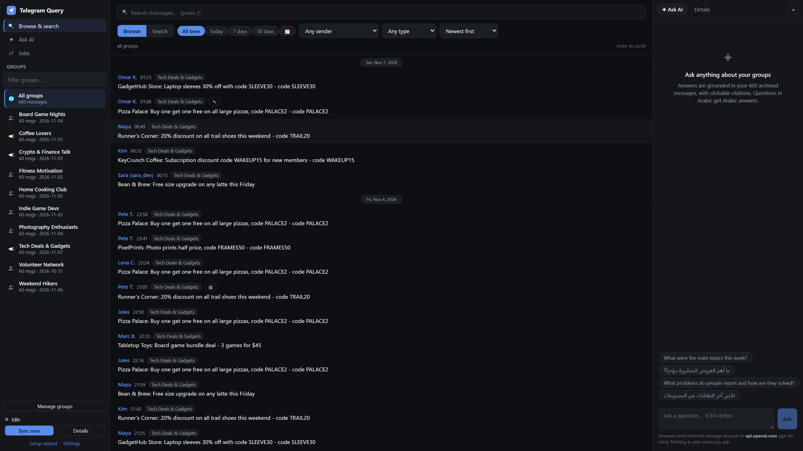
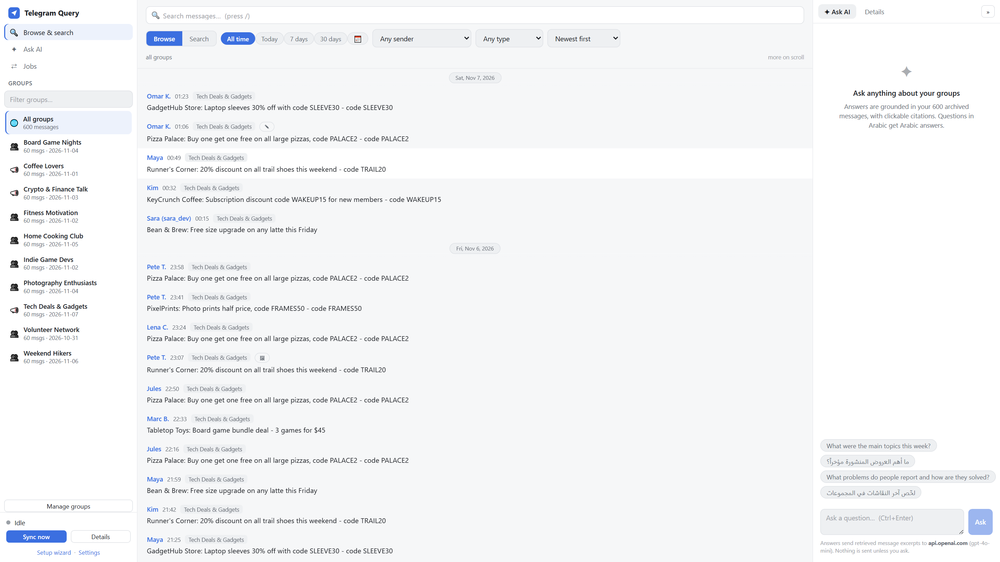
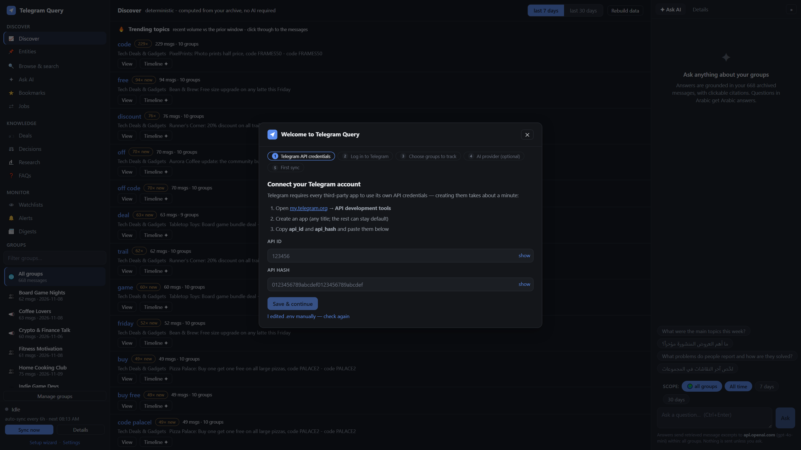
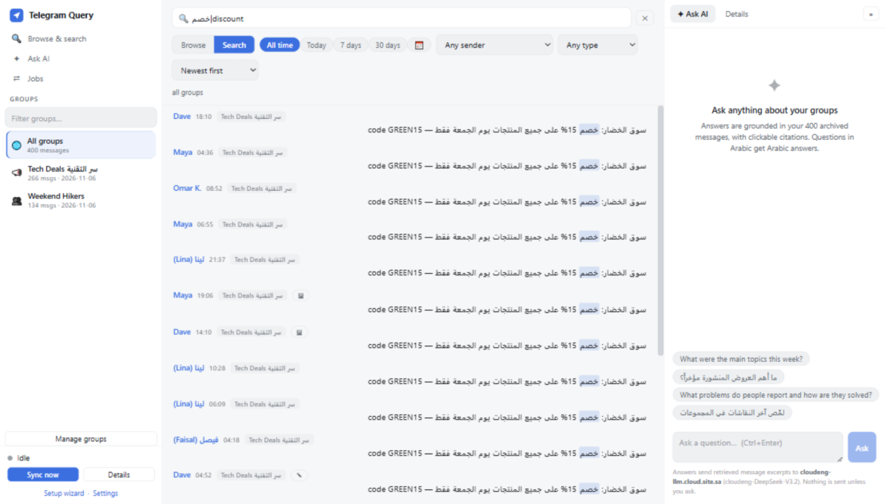

# Telegram Query

**A local-first, searchable, AI-queryable archive for your Telegram groups.**

Connect your Telegram account, track the groups you care about, and turn
them into a private, searchable knowledge base you own. Browse full history
with day separators and filters, run full-text searches across Arabic and
English, and ask questions answered *only* from your actual messages — with
clickable citations back to the originals.

Everything runs on your machine: the messages, the database, and your
Telegram session never leave it.

<p>
  
  
</p>

## Highlights

- **Local-first & private** — SQLite archive on your disk; no cloud, no
  telemetry. The server binds to `127.0.0.1` by default.
- **Full-history sync + auto-sync** — checkpointed backfills that
  pause/resume without losing progress, incremental updates, edit
  detection, flood-limit handling, a job queue with stop/cancel controls,
  and a restart-proof automatic sync schedule (on by default, every 6h,
  configurable).
- **Fast bilingual search** — FTS5 trigram index with Arabic/English
  normalization: diacritics, alef/ya variants, taa marbuta, plus extended
  rules — Arabic-Indic digits (٢٥→25), chat elongation (هااااي→هاي),
  Arabizi folding inside Latin words, and a Gulf dialect map (شلون↔كيف) —
  with mixed-language queries, term highlighting, date/sender/media/star
  filters, and search history.
- **Grounded Ask-AI with visible scope** — questions in Arabic or English
  answered from retrieved messages only, with `[n]` citations that jump to
  the original message, removable scope chips showing exactly which groups
  and dates are searched, and one-click Markdown export. Works with any
  OpenAI-compatible endpoint (OpenAI, Groq, OpenRouter, Ollama, LM Studio,
  vLLM…). Optional — disable it and nothing ever leaves your machine.
- **Keep what matters** — star messages, attach private notes (never sent
  to AI), save searches under a name and re-run them any time, and open any
  message in its original Telegram chat with verified deep links.
- **Deals extractor** — offers inside your groups become typed rows (vendor,
  code, discount, expiry) with per-row citations, cross-group dedupe,
  evidence-derived status, human confirm/correct controls, and optional
  incremental extraction after each sync.
- **Research briefs** — ask a question over selected groups and dates, get
  a saved, citation-validated, re-runnable brief with version history and
  deterministic staleness tracking.
- **Watchlists & alerts** — deterministic keyword monitors evaluated after
  every sync (no AI, no cost), with a new/read/archived alert inbox that
  jumps straight to the original message.
- **Digests & FAQs** — cited daily/weekly summaries on a schedule or on
  demand, and recurring questions clustered with drafted answers that
  nothing trusts until you approve them.
- **Works with zero groups on day one** — a built-in wizard walks you
  through API credentials, Telegram login (phone + code + 2FA), group
  selection, and your first sync.
- **Polished bilingual UI** — React frontend with light/dark themes,
  resizable panels, mobile navigation, first-class RTL and mixed-direction
  text rendering, and Markdown/JSON exports that are useful outside the
  app.



## Quick start

Requirements: **Python 3.10+**. Node is *not* required — the frontend
build is included.

```bash
git clone https://github.com/<you>/telegram-query.git
cd telegram-query
pip install -r requirements.txt

# 1. get your API credentials (one minute): https://my.telegram.org
#    -> API development tools -> create an app
#    (you'll paste them into the setup wizard - or pre-fill .env yourself)

# 2. run
python app.py               # -> http://127.0.0.1:8000
```

Open http://127.0.0.1:8000 — the wizard collects your API credentials,
walks you through Telegram login, lets you pick groups, optionally
configures an AI provider (with a live "test connection" button), and
starts your first sync. Everything it saves lands in your local `.env`.
See [docs/installation.md](docs/installation.md) for details, or try the
app with synthetic data instead: `python scripts/seed_demo.py`.



## Asking questions

Type a question in the Ask-AI panel — Arabic questions get Arabic answers:

- *"What were the main topics this week?"*
- *"ما أهم العروض المنشورة مؤخراً؟"*
- *"What problems do people report, and what fixed them?"*

Answers list the retrieved messages they are based on; every `[n]` citation
opens the original message.

> **Privacy note:** asking a question sends only the excerpts it retrieves
> to the AI endpoint you configured. Everything else stays local. See
> [docs/privacy.md](docs/privacy.md).

## Command line

`sync.py` exposes everything the UI does, for scripting:

```bash
python sync.py --login        # interactive Telegram login, then exit
python sync.py                # incremental sync of tracked groups
python sync.py --list         # list your groups
python sync.py --track <id>   # track a group + full backfill
python sync.py --untrack <id>
python sync.py --days 3       # re-scan last 3 days (catches edits)
python sync.py --full         # re-fetch entire history
```

## Configuration

All settings are environment variables (a `.env` file is loaded
automatically). Full reference: [docs/configuration.md](docs/configuration.md).

| Variable | Default | Purpose |
|---|---|---|
| `TG_API_ID` / `TG_API_HASH` | — | Telegram API credentials |
| `TG_SESSION_PATH` | `data/tg_session` | Session file location |
| `TG_DB_PATH` | `data/messages.db` | Archive database location |
| `SYNC_DAYS` | `3` | Edit re-scan window |
| `NORMALIZATION` | `extended` | Search normalization level (`standard` = v0.3 rules) |
| `TGQ_DIALECT_MAP` | built-in Gulf map | JSON override for dialect word mapping |
| `AI_BASE_URL` | OpenAI | Any OpenAI-compatible endpoint |
| `AI_API_KEY` | — | Enables Ask-AI when set |
| `AI_MODEL` | `gpt-4o-mini` | Model name |
| `TGQ_GROUPS_HINT` | — | Optional community description to sharpen keyword extraction |
| `HOST` / `PORT` | `127.0.0.1` / `8000` | Local bind address — keep it local |

The auto-sync schedule (on/off + interval) is configured in the app's
Settings screen and stored in your local database.

## Architecture

FastAPI backend + React/TypeScript frontend (built output committed under
`web/dist`, served by the backend — no Node needed at runtime). SQLite
with WAL, an FTS5 trigram external-content index maintained incrementally,
and a single-slot job runner so the Telegram session is never used
concurrently.

Details: [docs/architecture.md](docs/architecture.md).

## Development

```bash
pip install -r requirements.txt -r requirements-dev.txt
ruff check . && pytest
cd web && npm install && npm run typecheck && npm test && npm run build
```

Automated suites cover the DB/migrations, bilingual + Gulf/Arabizi search
normalization, sync checkpoints and resume, the job queue, the auto-sync
scheduler, the AI pipeline and scope (with a mocked provider - no real
credentials needed), setup/auth flows, saved searches, bookmarks and
notes, deep links, exports, and the citation mapping in the frontend.
Contributions welcome - see [CONTRIBUTING.md](CONTRIBUTING.md).

## Known limitations

- Media is archived as a marker (`[image]`), not downloaded.
- One Telegram account per installation (single session file).
- No multi-user auth: the UI assumes the person at localhost is you.
- Search indexes message *text*; OCR of image content is out of scope.
- Messages deleted on Telegram remain in your archive (the archive is a
  historical record; untrack & delete removes them locally).
- Jobs that are queued but not yet started don't survive an app restart;
  running jobs checkpoint and resume on the next sync.

## License

[MIT](LICENSE) — contributions under the same license.
